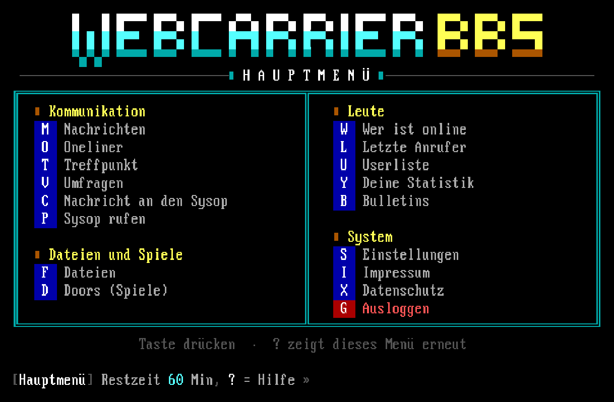
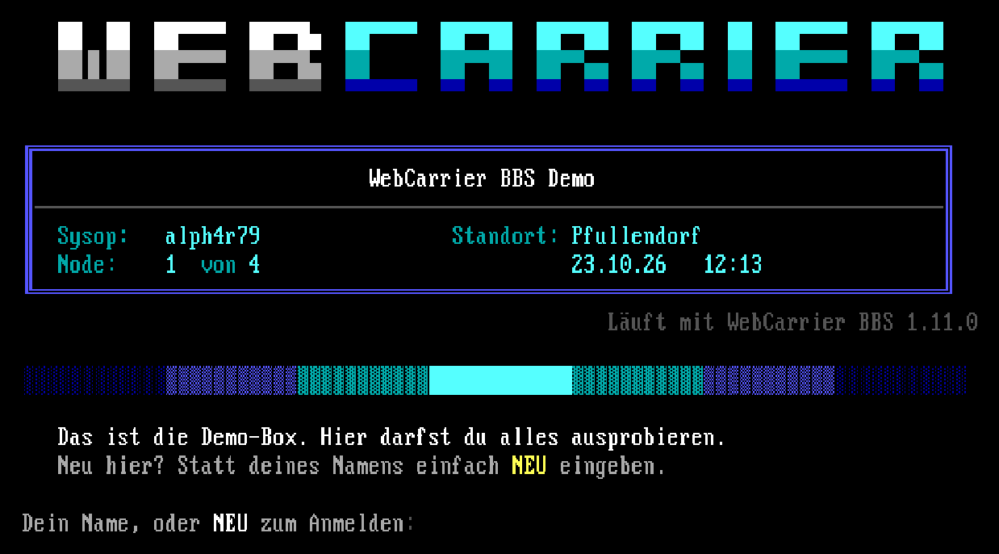
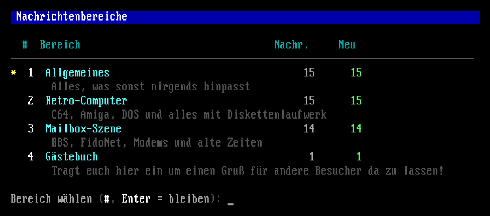
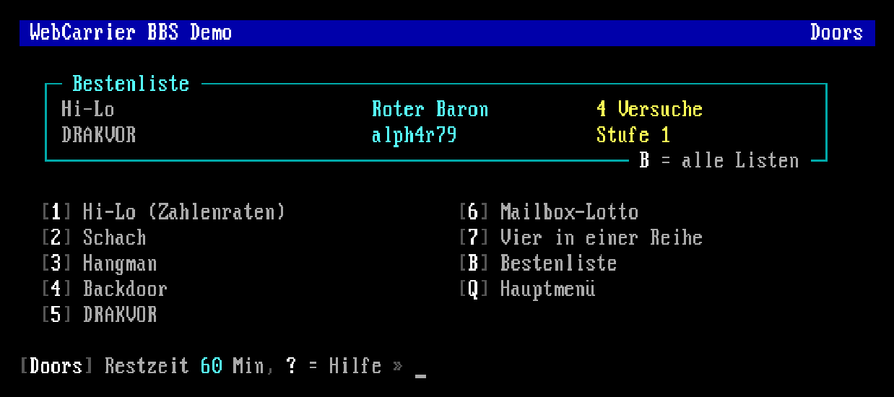

# WebCarrier BBS

A real mailbox from the nineties, running on ordinary PHP webspace.

Callers open your domain and land in an 80×25 DOS screen with the IBM VGA font, ANSI colours and a dial tone. From there on everything works like a BBS in 1994: log in or register, read and write messages, send private mail, browse file areas, download and upload, play doors, leave a oneliner. No mouse, keyboard only.

For the sysop there is a modern web backend: reading and answering messages and the own mail, chat with callers who page the sysop, reported messages, roles for moderators, a log with filters, settings, users, levels, message and file areas with bulk actions, menu editor, ANSI screen editor with live preview, approval of uploads, a ban list, a questionnaire for new users, automatic promotion by rules, a second factor for the login, own versions of every terminal text, statistics, polls, a message of the sysop shown after the login, a bulk import for whole shareware CDs, backups as ZIP download and a daily backup of the database.

Installing it works like WordPress: upload the folder, open `/install/`, fill in a form, done.

## Features

- Browser terminal: 80×25 text mode on a canvas, original IBM VGA 9×16 font, CP437, ANSI.SYS escape codes, blinking text, emulated modem speed (300 to 57600 bps), dial tones and handshake
- Optional tube effect with scanlines, glow and afterglow; a hint in the tab title when something happens while the tab is in the background
- Nodes with "All lines are busy", who's online, last callers, idle timeout, daily time limits; reloading the page (F5) does not hang up, the caller gets the same screen and prompt back
- After the login a box with what is new since the last call: messages, files, members, oneliners, polls and door high scores
- Message areas with read and write levels, new scan, search, reply threads, replies with quoting, line editor (`/S`, `/A`, `/L`), private mail
- Direct dial links like `#msg/123` that lead into a message or area after the call, and public boards: chosen areas readable as plain web pages without a call, with a sitemap for search engines
- File areas with listing, new files, search, viewing text and ANSI files, opening them in the ANSI editor WAnsiDraw, marked files, download, upload with FILE_ID.DIZ, daily download limits and upload/download ratio
- Upload check: the content must match the extension, damaged ZIP archives and doubles (by checksum, in any area) are refused; an optional BBS ad goes into every uploaded ZIP like in the old days
- Oneliners, user list, profiles with about me, signatures, personal statistics and settings, expert mode, page sysop
- Meeting point: a chat room for all callers online, messages to other nodes, polls
- Sysop menu in the terminal: chat with callers, broadcast, disconnect a node, review new users and uploads; optional validation of new users with a questionnaire
- Automatic promotion to higher levels by rules (calls, days, posts, uploads); second factor (TOTP) with backup codes for sysop accounts
- Menu system configurable in the backend (31 commands), ANSI or pipe code screens with macros
- Doors as small PHP classes, added to the menu with one click, example door included; a faulty door file is skipped instead of breaking the board
- A high score list for every door, with the leaders shown above the door menu
- Ban list for handles and words, own terminal texts per language that survive updates, statistics with calls, users, uploads and downloads
- Optional update check and one-click updates from the backend, with signed packages, a backup before every update and automatic rollback on errors
- German and English, SQLite (zero configuration) or MySQL/MariaDB

## Screenshots

The screens are taken from the demo board, which runs in German; the board is available in English as well. Try it yourself at [webcarrier-bbs.de/demo](https://webcarrier-bbs.de/demo/).

Welcome screen with logo and board info before the login:

List of the message areas with message counts and new messages:

Doors menu with the box of the high score leaders:

## Requirements

PHP 8.1 or newer with PDO (SQLite or MySQL) and mbstring. ZipArchive is optional and reads FILE_ID.DIZ, checks uploaded ZIP archives, adds the BBS ad and makes the backups. Apache with `.htaccess` works out of the box, for nginx see the sysop guide.

## Documentation

- [Sysop Guide](docs/SYSOP_GUIDE.md) (German)
- [User Guide](docs/USER_GUIDE.md) (German)
- [Door Guide](docs/DOOR_GUIDE.md) (German), how doors work and how to write your own
- [Changelog](CHANGELOG.md)

## Security

Please report security issues privately as described in [SECURITY.md](SECURITY.md), not in public issues.

## Deutsch

WebCarrier BBS ist eine Mailbox wie in den Neunzigern, die auf normalem PHP-Webspace läuft. Hochladen, `/install/` aufrufen, Formular ausfüllen, fertig. Anrufer bedienen die Box komplett per Tastatur in echter DOS-Optik, der Sysop verwaltet alles bequem im Web-Backend. Die Anleitungen liegen in `docs/`.

## License

Copyright (C) 2026 [Christoph Scheel](https://chrisscheel.de)

WebCarrier BBS is free software under the [GNU Affero General Public License v3.0 or later](LICENSE). If you run a modified version on a public server, the AGPL requires you to offer your changed source code to the callers. The terminal page and the backend link to the source, set `CB_SOURCE_URL` in `core/bootstrap.php` to your own repository.

The bundled VGA font is a dump of the IBM VGA ROM font and not covered by the AGPL, and the QR code generator in `assets/qrcode.js` is MIT licensed, see [NOTICE](NOTICE).
